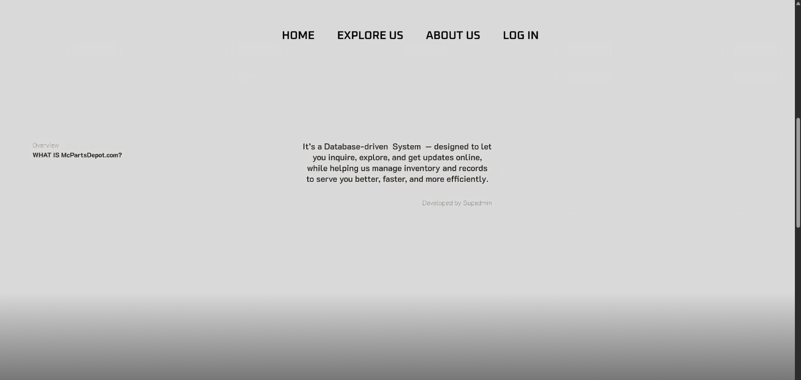
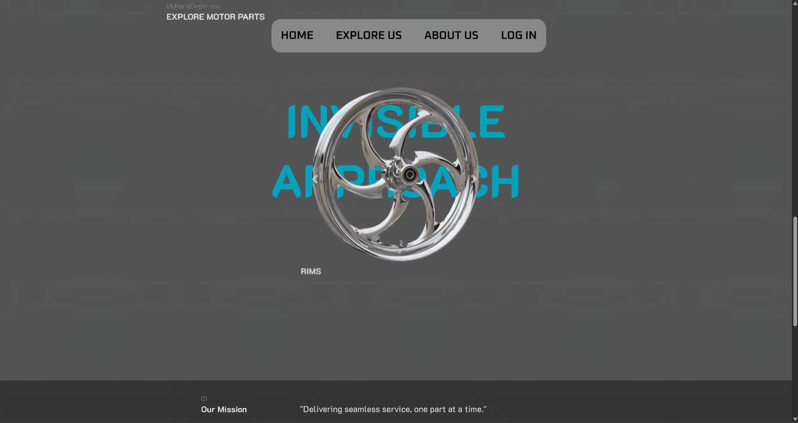
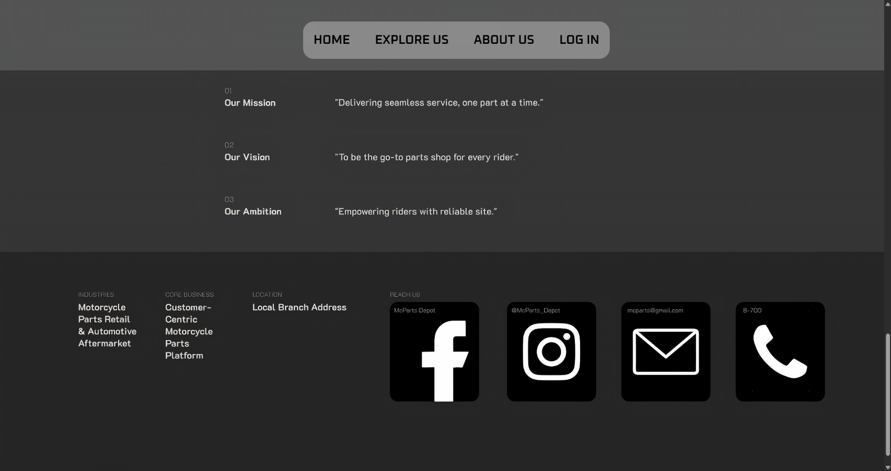
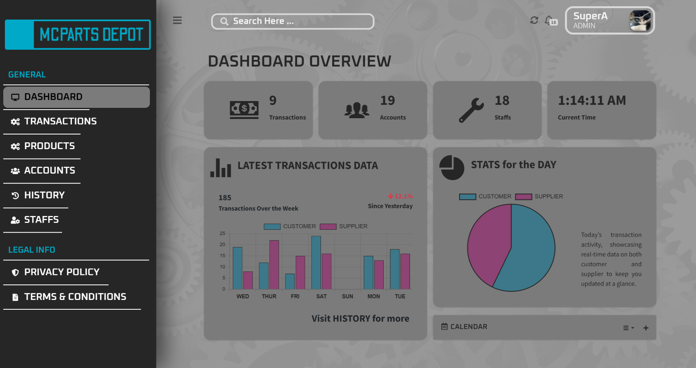
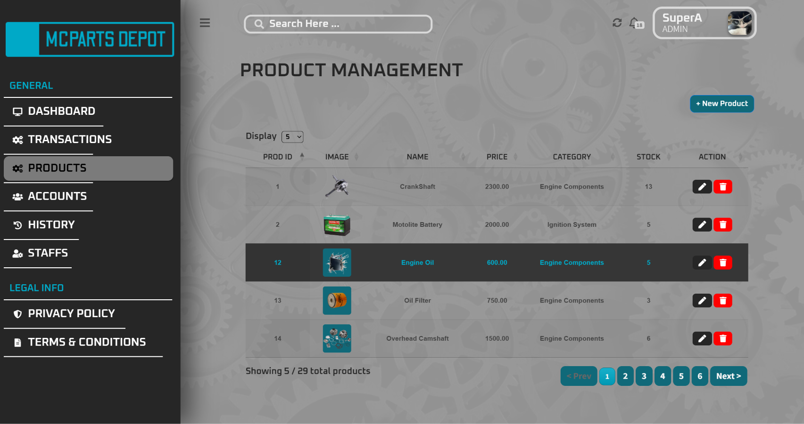
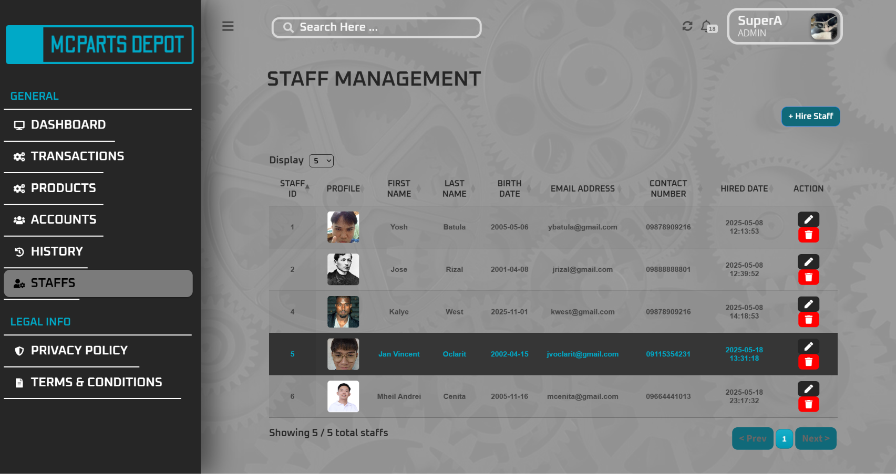
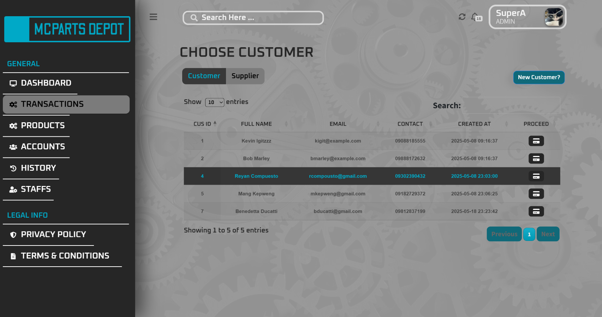

# McPartsDEPOT

A motorparts shop management system developed for **McPartsDEPOT**.

Built with HTML/CSS (Bootstrap) as the frontend, PHP as the backend, and MySQL as the database. Created in fulfillment of the **Database 2** final project.

---

## 📋 Table of Contents

- [About](#about)
- [Features](#features)
- [Tech Stack](#tech-stack)
- [Project Structure](#project-structure)
- [Installation](#installation)
- [Screenshots](#screenshots)
- [Database](#database)
- [License](#license)

---

## About

McPartsDEPOT is a web-based motorparts shop management system that handles product inventory, customer and supplier accounts, staff management, cart/checkout transactions, and transaction history. It provides both a public landing page for customers and an admin dashboard for staff operations.

---

## Features

- **Landing Page** — Public-facing storefront with product carousel and featured items.
- **Admin Dashboard** — Overview of shop metrics and quick actions.
- **Product Management** — Add, update, delete products; view stock levels.
- **Cart & Checkout** — Customer cart, checkout confirmation, and payment completion.
- **Customer Management** — Add, update, and delete customer records.
- **Supplier Management** — Manage suppliers and their accounts.
- **Staff Management** — Manage staff accounts and roles.
- **Transactions** — View customer and supplier transaction history.
- **Reports** — Generate shop reports.
- **Settings** — Configure shop settings.

---

## Tech Stack

| Layer | Technology |
|-------|------------|
| Frontend | HTML5, CSS3, Bootstrap |
| Backend | PHP |
| Database | MySQL |
| Server | Apache (XAMPP/WAMP recommended) |

---

## Project Structure

```
McPartsDEPOT/
├── admin/                  # Admin panel (dashboard, products, staff, etc.)
│   ├── assets/             # CSS, JS, images, plugins
│   ├── includes/           # Header, footer, sidebar, top-navbar
│   └── tables/             # Data table partials
├── components/             # Reusable PHP components (CRUD operations)
├── db_connect/             # Database connection
├── operations/             # Operation scripts
├── screenshots/            # Application screenshots
├── landing.php             # Public landing page
└── mcparts_trial.sql       # Database dump
```

---

## Installation

1. **Clone the repository**
   ```bash
   git clone https://github.com/<your-username>/McPartsDEPOT.git
   ```

2. **Move to your web server root** (e.g. `htdocs` for XAMPP).

3. **Import the database**
   - Open phpMyAdmin.
   - Create a database (e.g. `mcparts_trial`).
   - Import `mcparts_trial.sql`.

4. **Configure database connection**
   - Update the credentials in `db_connect/` to match your local MySQL setup.

5. **Run the app**
   - Start Apache & MySQL in XAMPP.
   - Visit `http://localhost/McPartsDEPOT/landing.php`.

---

## Screenshots

### Landing Page








### Dashboard



### Products



### Staff



### Transactions



---

## Database

The database schema and seed data are provided in `mcparts_trial.sql`. Import it into MySQL before running the application.

---

## License

This project is developed for academic purposes (Database 2 final project). All rights reserved.